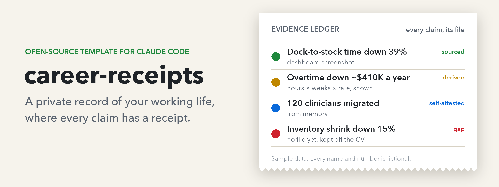
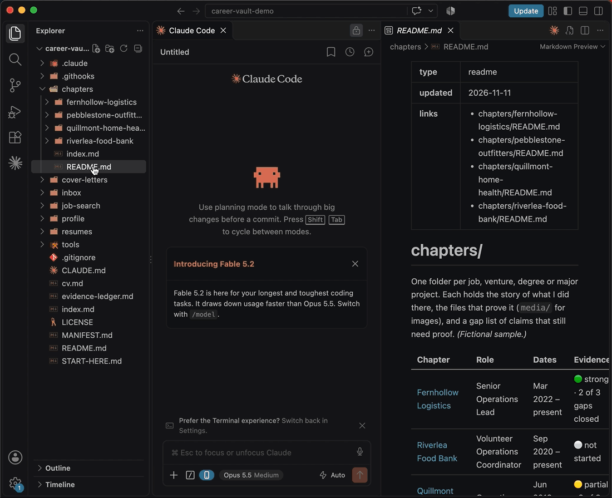
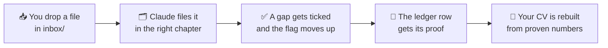

<!-- template-readme -->
<!-- This is the GitHub page for the template. When you say "set me up", Claude replaces it
     with your vault's own front page. -->

<p align="center">
  
</p>

<p align="center">
  <a href="LICENSE"></a>
  
  
  
</p>

<p align="center">
  <b>Hiring managers and promotion committees ask "how do you know that?"<br>
  This vault means you always have the answer.</b>
</p>

<p align="center">
  <a href="#start-here-no-tech-skills-needed">Start here</a> ·
  <a href="examples/sample-vault/README.md">See a filled-in example</a> ·
  <a href="#questions">Questions</a>
</p>

<p align="center">
  
  <br><sub>45 seconds: a claim with no proof, one dropped file, and the claim gets its receipt. Claude's working time is sped up.</sub>
</p>

---

**career-receipts** is a private folder on your computer that Claude Code keeps organized
for you. It holds every job, project and degree you've had, the files that prove what you
did there, and an **evidence ledger** that ties every number on your CV to a file.

Use it at review time, to build a promotion case, for a brag document, and for a job search
when one comes. You drop files in, and Claude does the sorting.

## What you get

| | |
|---|---|
| 📥 **Drop, don't sort** | Throw old resumes, screenshots, kudos emails and reviews into one `inbox` folder. Say *"file my inbox"* and Claude names each file, files it in the right place and writes down what it proves. |
| 🧾 **A receipt for every number** | Each number on your CV gets a row in the evidence ledger, honestly labeled: proven, worked out, from memory, or still missing. A number with no proof never reaches your CV. |
| 📈 **Progress you can see** | Each job gets a status flag and a to-do list of what's still unproven, so you always know which file is worth finding next. |
| 🔒 **Private and safe by default** | A built-in check stops ID, card and account numbers from ever being saved, and the vault refuses to back up anywhere that isn't private. |
| 💸 **Free to run** | It runs on your Claude subscription. No API keys, nothing billed per use. |

**[See a filled-in example →](examples/sample-vault/README.md)** It belongs to Robin
Castellane, an invented operations lead, and shows four jobs, an evidence ledger and a CV
where every number is sourced.

## How it works



Every chapter (a job, degree or project) carries a flag that works like a progress bar:

| Flag | Means |
|---|---|
| ⚪ | Not started yet |
| 🔴 | You've listed claims, but no files back them yet |
| 🟡 | Some claims have proof |
| 🟢 | Strong: most claims have proof |

Every number in the evidence ledger has a status:

| Status | Means | On your CV? |
|---|---|---|
| 🟢 Sourced | A file in the vault shows it | Yes |
| 🟡 Derived | Worked out from something documented, with the math written down | Yes |
| 🔵 Self-attested | From memory, because the proof stayed with an old employer | Yes, and be ready to say "from memory" |
| 🔴 Gap | No file yet | **Never** |

## Start here (no tech skills needed)

This takes about 20 minutes, most of it waiting for installs. These steps are for a Mac.
On Windows, see [Questions](#questions).

**1. Get the two free apps.**
- Download and install [**VS Code**](https://code.visualstudio.com).
- Open VS Code. Click the **Extensions** icon in the left sidebar (four small squares),
  search for **Claude Code**, and click **Install** on the one published by **Anthropic**.
- Sign in with your Claude account when it asks. You need a **Claude Pro or Max** plan.

**2. Download the vault.**
- Click this link: [**career-vault.zip**](https://github.com/dk-ui/career-receipts/releases/latest/download/career-vault.zip).
- Double-click the downloaded file to unzip it. You get a folder called `career-vault`.

**3. Put it in your home folder.**
- In Finder, click **Go → Home** in the menu bar (it's the folder with your name and a house
  icon).
- Drag the `career-vault` folder in there.
- **Not** Documents, Desktop, Downloads or iCloud. Syncing services can scramble the vault's
  history.

**4. Open it.**
- In VS Code, click **File → Open Folder…**, choose `career-vault`, and click **Open**.
- If VS Code asks whether you trust the folder's authors, click **Yes**.

**5. Say hi.**
- Open Claude Code (click the Claude icon in VS Code) and type: **`set me up`**

That's it. Claude checks your computer, installs anything missing (it asks first), asks you
five quick questions, and asks for your current resume. You finish with a CV where every
number has a row in your evidence ledger.

After that, whenever you have 20 minutes, say **`what's next`**. Claude does one step at a
time: your work history, your old files, a private backup, prep for your next review.

<details>
<summary><b>Comfortable with git? Two faster ways</b></summary>

- **Use this template** (green button, top right) → **choose Private** → Create, then clone
  your new repo into your home folder. GitHub makes new repos **public** by default, so check
  that you chose Private. Your vault holds your work history.
- **Or clone this repo directly:**
  ```sh
  cd ~ && git clone https://github.com/dk-ui/career-receipts.git career-vault
  ```
  Setup disconnects it from this public repo before your first save, so your vault can never
  be pushed here.

Then open the folder in VS Code and say `set me up`.

No clone at all? [SETUP-PROMPT.md](SETUP-PROMPT.md) builds the same vault from one prompt in
an empty folder.
</details>

## What you'll say to Claude

| Say | What happens |
|---|---|
| `set me up` | First-time setup, about 15 minutes |
| `file my inbox` | Everything in `inbox/` gets named, filed, described and checked off |
| `update my CV` | Your CV is rebuilt from the vault, and any number without proof is flagged |
| `what's next` | One step deeper: history, old files, backup, review prep |
| Just tell it | "I led the move to the new scheduling system last spring" gets written into the right chapter |

Claude never sends, submits or posts anything for you. It drafts, and you hit send.

## Privacy and safety

- **Your vault stays private.** Everything lives on your computer. The optional backup is a
  **private** GitHub repo, and the vault checks that it's private before every upload.
- **ID numbers are blocked.** A check runs before every save and stops anything that looks
  like a Social Security, card, account, passport or license number.
- **Don't drop ID documents in at all.** The check reads text, not photos or PDFs, so keep
  passports, licenses and bank statements out.
- **Other people stay protected.** References and colleague quotes stay inside the vault
  unless that person agreed.

## Costs

Everything runs on your Claude Pro or Max subscription. **Never add an API key.** The vault
never needs one, and Claude is told to ask before anything that could cost money.

## Questions

<details>
<summary><b>Do I need to know how to code?</b></summary>

No. You type plain sentences to Claude. The code in this repo runs on its own in the
background.
</details>

<details>
<summary><b>I'm not job hunting. Is this still for me?</b></summary>

Yes, that's the main use. Most people reach for it at review time or when building a
promotion case. A job search is just one more thing it's ready for.
</details>

<details>
<summary><b>Does it work on Windows?</b></summary>

It's built and tested on a Mac. Windows is untested: it should work with
[Git for Windows](https://git-scm.com) and [Python](https://www.python.org/downloads/)
installed, with the folder in your user folder rather than OneDrive. If you try it, please
[open an issue](https://github.com/dk-ui/career-receipts/issues) and say how it went.
</details>

<details>
<summary><b>Is my data sent anywhere?</b></summary>

Your files stay on your computer. Claude reads them to help you, under
[Anthropic's privacy terms](https://www.anthropic.com/legal/privacy). Nothing is published.
The only upload is the optional private backup you set up yourself.
</details>

<details>
<summary><b>What's the example folder, and can I delete it?</b></summary>

`examples/sample-vault` is a made-up person's finished vault, so you can see where you're
heading. Setup offers to show it to you, then offers to delete it. The zip download doesn't
include it.
</details>

<details>
<summary><b>Can it help me apply for jobs?</b></summary>

Yes, optionally. When you're looking, setup can add
[career-ops](https://github.com/santifer/career-ops), an open-source job-search engine. It
scores postings against your background and tailors a CV for each one, using only proven
numbers from your vault.
</details>

## Troubleshooting

| What you see | Fix |
|---|---|
| Claude doesn't seem to know about the vault | Check that VS Code opened the `career-vault` folder itself (its name is at the top of the file list), not a folder around it. |
| Claude says the folder is in the wrong place | Move `career-vault` to your home folder (step 3), then reopen it in VS Code. |
| "commit blocked by the privacy gate" | The check found something that looks like an ID number. Claude shows the file and line. Remove the number, keep only what a CV needs, and try again. |
| Claude says git or python3 is missing | Say *"install what's missing"*. On a Mac it's one Apple installer, about 5 minutes. |
| The zip link says "Not Found" | Use the green **Code → Download ZIP** button at the top of this page instead, then rename the unzipped folder to `career-vault`. |

## What's in here

```
.
├── START-HERE.md          plain-language guide for the vault's owner
├── CLAUDE.md              the rules Claude follows in your vault
├── evidence-ledger.md     every CV claim → the file that proves it
├── inbox/                 drop zone, filed and emptied each session
├── profile/               who you are, what you're aiming for, headshots
├── chapters/              one folder per job, degree or project
├── resumes/  cover-letters/  job-search/
├── tools/                 privacy check, generators, claims check, tests (Python, no installs)
├── .githooks/             the checks that run before every save and upload
├── .claude/skills/        setup-vault, file-inbox, add-chapter, sync-cv, sync-career-ops
├── examples/sample-vault/ a fictional filled-in vault (removed at setup)
└── SETUP-PROMPT.md        build it from one prompt instead
```

## Credits and contributing

The optional job-search step uses [santifer/career-ops](https://github.com/santifer/career-ops)
(MIT). Thanks to its author for building it and releasing it openly.

Ideas and fixes are welcome. See [CONTRIBUTING](.github/CONTRIBUTING.md). Please never paste
anything from your own vault into an issue.

## License

[MIT](LICENSE). Free to use, change and share.
